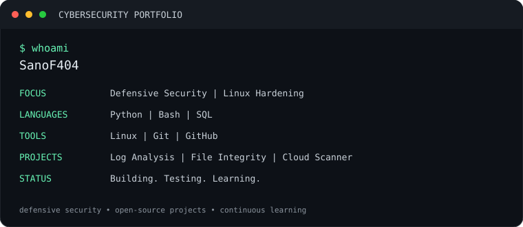
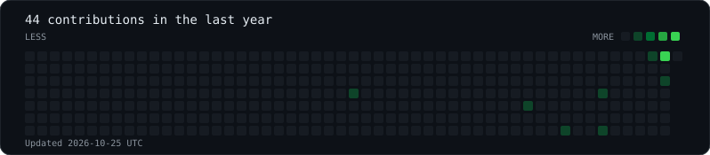

<div align="center">

# SanoF404

**Cybersecurity Portfolio | Defensive Security | Linux**


<br>

<br>


</div>

## Projects

- **Linux Server Hardening** - Security checks and system-hardening documentation.
- **Python Authentication Log Analyzer** - Analyzes failed authentication attempts.
- **File Integrity Monitor** - Detects file changes using cryptographic hashes.
- **Cloud Security Misconfiguration Scanner** - Checks for common defensive security issues.

## Skills

`Linux` | `Python` | `Bash` | `Git` | `GitHub Actions` | `SQL` | `Defensive Security`

## Local Generation

```bash
python -m pip install -r requirements.txt
python generate_card.py
python generate_ascii.py --input assets/avatar.jpg
python generate_heatmap.py
```

The heatmap generator requires a GitHub token. Keep tokens in environment variables or GitHub Actions secrets. Never commit tokens.

